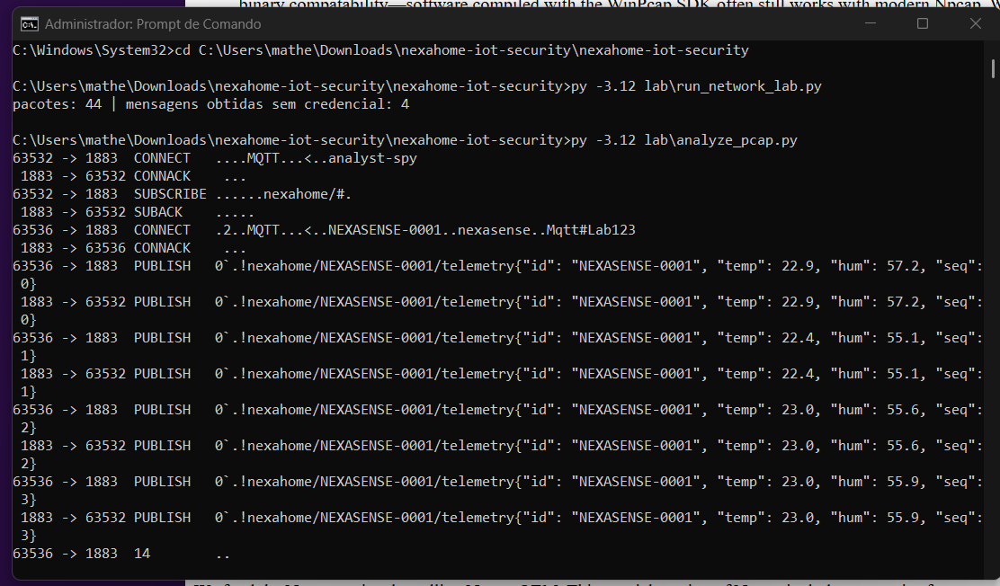

# Análise de protocolos (laboratório local)

Ambiente: broker MQTT (`amqtt`) em 127.0.0.1:1883 + dispositivo simulado (`paho-mqtt`) + captura com Scapy na interface `lo`. Nada sai da máquina. As credenciais usadas pelo dispositivo simulado foram **extraídas do próprio firmware** (demonstração controlada).

| Aspecto | Observado | Evidência |
|---|---|---|
| Protocolo | MQTT 3.1.1 sobre TCP/1883 | `evidence/pcap_analysis.txt` |
| Origem → destino | dispositivo (porta efêmera) → broker 127.0.0.1:1883 | `evidence/mqtt_lab.pcap` |
| Autenticação | usuário/senha enviados no CONNECT, mas o broker de laboratório também aceita anônimos | CONNECT + `anonymous_subscriber.txt` |
| Criptografia | **Nenhuma** (sem TLS) | senha `Mqtt#Lab123` visível no pacote |
| Identificadores | `NEXASENSE-0001` no clientid, tópico e payload | pcap |
| Mensagens de controle | CONNECT/CONNACK/SUBSCRIBE/SUBACK/PINGREQ | pcap |
| Dados sensíveis | credenciais MQTT; telemetria (temperatura/umidade/seq) | pcap |

## Identificar ≠ avaliar
Identificar “MQTT” só diz *o que* é falado. Para saber se é seguro é preciso verificar *como*: aqui o protocolo é legítimo, mas usado sem TLS, com credencial compartilhada e sem ACL. O mesmo MQTT sobre TLS 8883 com certificado por dispositivo e ACL seria aceitável.

## Limitações
- Broker e dispositivo são simulados; o tráfego real do hardware pode diferir (ex.: Wi-Fi WPA2 protege o enlace, mas não contra quem já está na rede).
- OTA e `/debug` foram avaliados apenas por strings/configuração, sem teste dinâmico.

## Execução no notebook Windows (01/11/2026)

Npcap 1.90, Python 3.12: 44 pacotes capturados; CONNECT com `nexasense` / `Mqtt#Lab123` em claro; 4 mensagens lidas sem credenciais.
